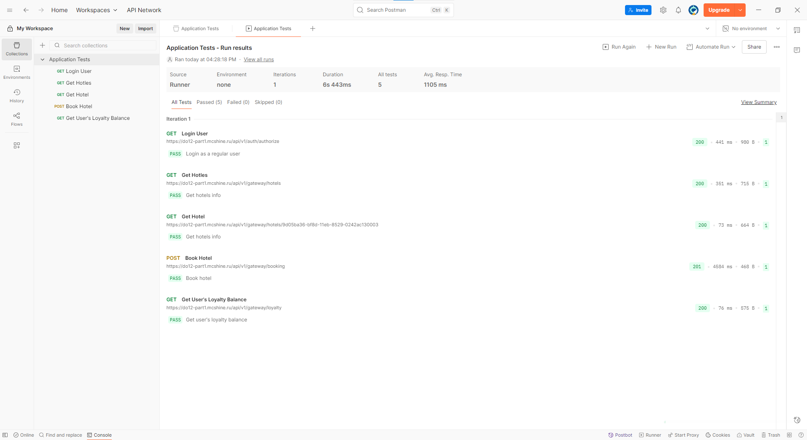
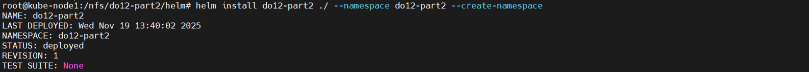
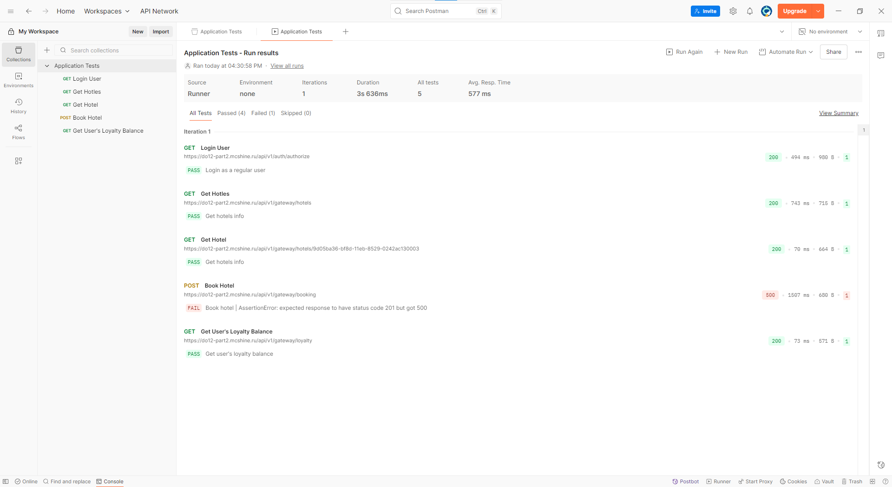
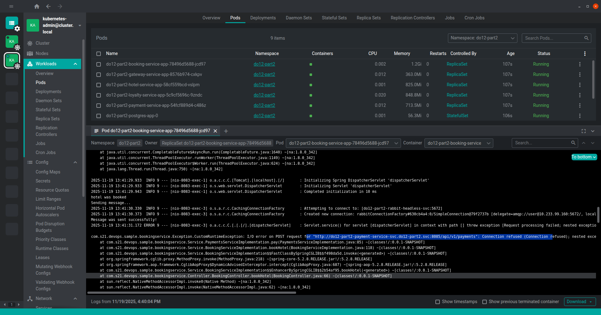
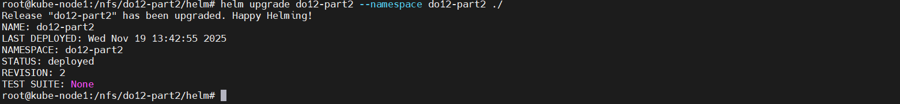

## Part 1. Развертывание приложения с помощью Kustomize

Мне нравится делать развернутые презентации и максимально описывать действия, чтобы сдача проекта превращалась в минилекцию.\
Однако, тут я не знаю, что писать. Kustomize - довольно простой инструмент. Да, вероятно, где-то можно сильно пропатчить деплой так, что создатель его не узнает. Но в нашем случае ентого не требуется, да и не знаю, что в ентом проекте можно навертеть. 

Поентому, просто прошу к просмотру папки в src/do12-part1.

Ну, разве что приведу описание самих Kustomize файлов.

Базовый:
```
apiVersion: kustomize.config.k8s.io/v1beta1
kind: Kustomization
resources:
  - ./harbor-secret.yaml
  - ./do12-part1-ns.yaml
  - ./rabbitmq/rabbitmq-headless-svc.yaml
  - ./rabbitmq/rabbitmq-statefulset.yaml
  - ./postgresql/postgres-storclass.yaml
  - ./postgresql/postgres-pv.yaml
  - ./postgresql/postgres-headless-svc.yaml
  - ./postgresql/postgres-statefulset.yaml
  - ./applications/do12-ingress.yaml
  - ./applications/deployments/booking-deploy.yaml
  - ./applications/deployments/gateway-deploy.yaml
  - ./applications/deployments/hotel-deploy.yaml
  - ./applications/deployments/loyalty-deploy.yaml
  - ./applications/deployments/payment-deploy.yaml
  - ./applications/deployments/report-deploy.yaml
  - ./applications/deployments/session-deploy.yaml
  - ./applications/services/booking-svc.yaml
  - ./applications/services/gateway-svc.yaml
  - ./applications/services/hotel-svc.yaml
  - ./applications/services/loyalty-svc.yaml
  - ./applications/services/payment-svc.yaml
  - ./applications/services/report-svc.yaml
  - ./applications/services/session-svc.yaml
```

Т.е. тупо перебираем все неизменяемые файлы.

Продактовый:
```
apiVersion: kustomize.config.k8s.io/v1beta1
kind: Kustomization
//Все конфиги и секреты
resources:
- ../../base
- ./rabbitmq/rabbitmq-secrets.yaml
- ./rabbitmq/rabbitmq-config.yaml
- ./postgresql/postgres-secrets.yaml
- ./applications/confmaps/booking-config.yaml
- ./applications/confmaps/gateway-config.yaml
- ./applications/confmaps/hotel-config.yaml
- ./applications/confmaps/loyalty-config.yaml
- ./applications/confmaps/payment-config.yaml
- ./applications/confmaps/report-config.yaml
- ./applications/confmaps/session-config.yaml
- ./applications/secrets/booking-secret.yaml
- ./applications/secrets/hotel-secret.yaml
- ./applications/secrets/loyalty-secret.yaml
- ./applications/secrets/payment-secret.yaml
- ./applications/secrets/report-secret.yaml
- ./applications/secrets/session-secret.yaml
//Укажем неймспейс
namespace: do12-part1-prod
//Добавим меток
labels:
- includeSelectors: true
  pairs:
    environment: production
//Требуемый патч
patches:
- path: ./replicas-patch.yaml
```

И патч:
```
apiVersion: apps/v1
kind: Deployment
metadata:
  labels:
    app: gateway-service-app
  name: gateway-service-app
  namespace: do12-part1
spec:
  replicas: 3
```

Теперь из каталога overlays/prodaction запускаем 
```
kubectl apply -k
```
и все, закончили.

Вот Постман:



Ну и приложим итоговый yaml, через который тоже можно развернуть.

## Part 2. Развертывание приложения с помощью Helm

Тут чуть поинтереснее. Так как можно много перевести в полную шаблонизацию.

Однако, енто палка о двух концах. И можно в сети наткнуться на споры - а хорошее ли енто дело вообще. Не лучше ли все же сидеть в манифестах.

Аргумент "за" - Удобнее для обычного пользователя. Запустил и забыл.\
Аргумент "против" - хуже для девопса. Если надо поменять что-то, то надо разбираться в чужом коде. А мы, вроде как, не программисты.

Т.е. все шаблонизаторы работают по принципу перевода некоторых аргументов в строки yaml. И не очень удобно читаются.\
Лучшим бы вариантом была бы программа, где можно было бы задать параметры под кластер, а она вывела бы манифест.

Но, пока такой программы нет, будем пользоваться тем, что есть, но, постараемся не превратить проект в чудовище Франкенштейна.

Начнем с простого. С некоторого заполнения values.yaml:
```
projectName: do12-part2
version: 0.0.1

//Енти метки будем пихать во все сущности нашего проекта
labels:
  project: do12-part2
  env: prod

//Мы можем качать имейджи нашего проекта с разных источников.
//Поентому сделаем список (используя "-") всех докер логинов
imagePullSecrets: 
  - name: regcred
    value: <Your Docker Login in base64>
```

Теперь будем делать наши секреты с логинами docker-secret.yaml:
```
//Енто чтоб не потерять контекст
{{ $top := . }}
//Вот тут читаем список логинов и делаем цикл
{{ range .Values.imagePullSecrets }}
//Вот хорошая практика. Ведь потом можно все слить в один конечный файл. Все надо разделять.
---
apiVersion: v1
kind: Secret
metadata:
  labels:
    //Вот тут нельзя просто написать .Values.version, так как контекст где-то в .Values.imagePullSecrets
    //Потому надо использовать указатель $top
    version: {{ $top.Values.version }}
    {{- with $top.Values.labels }}
    {{- toYaml . | nindent 4 }}
    {{- end }}
  //Зато в контесте можно указывать его значения напрямую.
  name: {{ .name }}
  namespace: {{ $top.Release.Namespace }}
type: kubernetes.io/dockerconfigjson
data:
  .dockerconfigjson: 
    {{ .value }}
{{ end }}
```

Далее, подумаем вот над чем. У нас железобетонная часть проекта - сервисы. А вот база данных, манагер очередей и ингресс контроллер в обязательный список не входят.

Поентому тут будем делать некую вариативность. В файл values.yaml добавим:
```
rabbitMQ:
  # Do not fill to use default values
  # Login and Pass should be in Base64
  rabbitLogin:
  rabbitPass:
  rabbitQueue:
  rabbitExchange:
  rabbitPort:
  //Если пользователь захочет воспользоваться своим/внешним раббитом,
  //то пусть запишет его хост/адрес/сервис сюда.
  //Пустая строка будет означать, что мы его ставим по шаблону
  # If you are using your own RabbitMQ, then fill "rabbitHost"
  rabbitHost:

postgres:
  # Do not fill to use default values
  # Login and Pass should be in Base64
  dbLogin:
  dbPass:
  dbPort:
  //Если не заполнить енту строку, то база будет работать без персистант волюма
  pvLocalPath: /nfs/do12-part2/storage/postgresql/data
  image: docker.mcshine.ru/library/do12-db:0.1
  //Посокльку образ собран нами, то и укажем, каким секретом его качать
  imagePullSecrets: 
    enabled: true
    name: regcred
  //Если пользователь захочет воспользоваться своим/внешним Postgresql,
  //то пусть запишет его хост/адрес/сервис сюда.
  //Пустая строка будет означать, что мы его ставим по шаблону
  # If you are using your own database, then fill "dbHost"
  dbHost:

ingress:
  //Надо ли делать ингресс по шаблону и, если надо, то основные параметры
  enabled: true
  className: "contour"
  annotations:
    cert-manager.io/cluster-issuer: letsencrypt-prod
    ingress.kubernetes.io/force-ssl-redirect: "true"
    kubernetes.io/tls-acme: "true"
  host: do12-part2.mcshine.ru
  tlsSecretName: do12-part2.mcshine.ru
```

Далее разберемся с ингресс application/app-ingress.yaml:
```
{{ $top := . }}
//Данный ямл создастся только если ingress.enabled = true
{{- if .Values.ingress.enabled -}}
---
apiVersion: networking.k8s.io/v1
kind: Ingress
metadata:
  labels:
    version: {{ .Values.version }}
    {{- with .Values.labels }}
    {{- toYaml . | nindent 4 }}
    {{- end }}
  name: {{ .Values.projectName }}-ingress
  namespace: {{ .Release.Namespace }}
  annotations:
    //Аннотации записываем, как и метки, через with, потому как в том списке нет "-"
    {{- with .Values.ingress.annotations }}
    {{- toYaml . | nindent 4 }}
    {{- end }}
spec:
  ingressClassName: {{ .Values.ingress.className }}
  {{- if .Values.ingress.tlsSecretName }}
  tls:
    - secretName: {{ .Values.ingress.tlsSecretName }}
      hosts:
        - {{ .Values.ingress.host }}
  {{- end }}
  rules:
    - host: {{ .Values.ingress.host }}
      http:
        paths:
        //А вот тут обращаемся к списку сервисов. И, если у сервиса записано,
        //что у него есть выход наружу, то записываем.
        //Тут цикл range
        {{- range .Values.microServices }}
        {{- if .ingressPath }}
        - path: {{ .ingressPath }}
          pathType: Prefix
          backend:
            service:
              name: {{ $top.Values.projectName }}-{{ .name }}-service-svc
              port:
                number: {{ .port }}
        {{- end }}
        {{- end }}
{{- end }}
```

Описывать тут, как мы делаем Раббит, не будем. Оно идет по аналогии с БД. Но у БД есть ПВ, и т.д. и т.п.

postgres/postgres-storclass.yaml:
```
//Обрабатываем два условия - чтоб не использовалась внешняя БД,
//и чтоб был указан путь до ПВ
{{ if not .Values.postgres.dbHost }}
{{ if .Values.postgres.pvLocalPath }}
---
apiVersion: storage.k8s.io/v1
kind: StorageClass
metadata:
  name: {{ .Values.projectName }}-postgres-storage-class
provisioner: kubernetes.io/no-provisioner
volumeBindingMode: WaitForFirstConsumer
{{ end }}
{{ end }}
```

postgres/postgres-pv.yaml:
```
//Условия те же
{{ if not .Values.postgres.dbHost }}
{{ if .Values.postgres.pvLocalPath }}
---
apiVersion: v1
kind: PersistentVolume
metadata:
  name: {{ .Values.projectName }}-postgres-data-pv
  labels:
    version: {{ .Values.version }}
    {{- with .Values.labels }}
    {{- toYaml . | nindent 4 }}
    {{- end }}
spec:
  //Вообще, можно почти всё выносить в переменные
  //Но и читать неудобнее, и в данном проекте и не нужно
  capacity:
    storage: 1Gi
  storageClassName: {{ .Values.projectName }}-postgres-storage-class
  volumeMode: Filesystem
  accessModes:
    - ReadWriteOnce
  persistentVolumeReclaimPolicy: Retain
  hostPath:
    path: {{ .Values.postgres.pvLocalPath }}
    type: DirectoryOrCreate
{{ end }}
{{ end }}
```

В файле postgres/postgres-statefulset.yaml подсветим только важные куски кода:
```
//Условие, что не используем внешнюю БД
{{ if not .Values.postgres.dbHost }}
---
...
          //Если надо сделать ПВ, то монтируем в контейнере.
          {{- if .Values.postgres.pvLocalPath }}
          - name: PGDATA
            value: /data/pgdata
          {{- end }}
...
        //Кто-то может использовать нестандартный порт.
        //Но, если в values.yaml пустая строка порта, то тут проставляем дефолтный.
        //Т.е. можно учесть, что пользователь забудет написать.
        ports:
          {{- if .Values.postgres.dbPort }}
          - containerPort: {{ .Values.postgres.dbPort }}
          {{- else }}
          - containerPort: 5432
          {{- end }}
            name: postgres
...
        {{- if .Values.postgres.pvLocalPath }}
        volumeMounts:
          - name: postgres-data
            mountPath: /data
        {{- end }}
...
      //Опять же, у кого-то образ молжет быть в открытом хоронилище
      {{- if .Values.postgres.imagePullSecrets.enabled }}
      imagePullSecrets:
        - name: {{ .Values.postgres.imagePullSecrets.name }}
      {{- end }}
...
  {{- if .Values.postgres.pvLocalPath }}
  volumeClaimTemplates:
  - metadata:
      name: postgres-data
    spec:
      accessModes: [ "ReadWriteOnce" ]
      storageClassName: "{{ .Values.projectName }}-postgres-storage-class"
      resources:
        requests:
          storage: 1Gi
  {{- end }}
...
```

Теперь чуть поинтереснее. Наши сервисы в values.yamlбудем описывать как список структур:
```
microServices:
    //Имя деплоя
  - name: booking
    //Имя сервиса
    serviceName: booking-service
    //Туть понятно
    image: docker.mcshine.ru/library/do12-booking:0.1
    //Туть тоже
    port: 8083
    //Имя базы данной
    dbName: reservations_db
    //Будет ли сервис использовать манагер очереди сообщений
    useRabbit: true
    //Количество реплик
    replicaCount: 1
    //Требуется ли логиниться, для скачивания образа
    imagePullSecrets: 
      enabled: true
      name: regcred
```

И вот под такую структуру мы могем подогнать один шаблонный манифест разом для всех наших приложениев.

Конфиги app-config.yaml:
```
{{ $top := . }}
{{ range .Values.microServices }}
---
apiVersion: v1
kind: ConfigMap
metadata:
  labels:
    version: {{ $top.Values.version }}
    {{- with $top.Values.labels }}
    {{- toYaml . | nindent 4 }}
    {{- end }}
    app: {{ $top.Values.projectName }}-{{ .name }}-service-app
  name: {{ $top.Values.projectName }}-{{ .name }}-service-config
  namespace: {{ $top.Release.Namespace }}
data:
  srv_envs: |
    //Если приложение использет БД
    {{- if .dbName }}
    //Если используется внешняя БД
    {{- if $top.Values.postgres.dbHost }}
    //Тогда указываем его в качестве хоста БД
    POSTGRES_HOST={{ $top.Values.postgres.dbHost }}
    {{- else }}
    //Если же нет, то указываем ДНС нашего БД сервиса
    POSTGRES_HOST={{ $top.Values.projectName }}-postgres-headless-svc
    {{- end }}
    //Если порт указали, то пишем его. Если нет, то стандартный
    {{- if $top.Values.postgres.dbPort }}
    POSTGRES_PORT={{ $top.Values.postgres.dbPort }}
    {{- else }}
    POSTGRES_PORT=5432
    {{- end }}
    POSTGRES_DB={{ .dbName }}
    {{- end }}
    //С раббитом та же байда
    {{- if .useRabbit }}
    {{- if $top.Values.rabbitMQ.rabbitHost }}
    RABBIT_MQ_HOST={{ $top.Values.rabbitMQ.rabbitHost }}
    {{- else }}
    RABBIT_MQ_HOST={{ $top.Values.projectName }}-rabbit-headless-svc
    {{- end }}
    {{- if $top.Values.rabbitMQ.rabbitPort }}
    RABBIT_MQ_PORT={{ $top.Values.rabbitMQ.rabbitPort }}
    {{- else }}
    RABBIT_MQ_PORT=5672
    {{- end }}
    {{- if $top.Values.rabbitMQ.rabbitQueue }}
    RABBIT_MQ_QUEUE_NAME={{ $top.Values.rabbitMQ.rabbitQueue }}
    {{- else }}
    RABBIT_MQ_QUEUE_NAME=messagequeue
    {{- end }}
    {{- if $top.Values.rabbitMQ.rabbitExchange }}
    RABBIT_MQ_EXCHANGE={{ $top.Values.rabbitMQ.rabbitExchange }}
    {{- else }}
    RABBIT_MQ_EXCHANGE=messagequeue-exchange
    {{- end }}
    {{- end }}
    //А дальше циклом пишем все сервисы и их порты.
    //Да, все сервисы знают друг о друге, но в данном проекте не вижу в ентом проблемы
    {{- range $top.Values.microServices }}
    {{ (upper .name) }}_SERVICE_HOST={{ $top.Values.projectName }}-{{ .name }}-service-svc.{{ $top.Values.projectName }}.svc
    {{ (upper .name) }}_SERVICE_PORT={{ .port }}
    {{- end }}
{{ end }}
```

Результат будет такой:
```
apiVersion: v1
kind: ConfigMap
metadata:
  labels:
    env: prod
    project: do12-part2
    version: 0.0.1
  name: do12-part2-booking-service-config
  namespace: do12-part2
data:
  srv_envs: |
    POSTGRES_HOST=do12-part2-postgres-headless-svc
    POSTGRES_PORT=5432
    POSTGRES_DB=reservations_db
    RABBIT_MQ_HOST=do12-part2-rabbit-headless-svc
    RABBIT_MQ_PORT=5672
    RABBIT_MQ_QUEUE_NAME=messagequeue
    RABBIT_MQ_EXCHANGE=messagequeue-exchange
    BOOKING_SERVICE_HOST=do12-part2-booking-service-svc.do12-part2.svc
    BOOKING_SERVICE_PORT=8083
    GATEWAY_SERVICE_HOST=do12-part2-gateway-service-svc.do12-part2.svc
    GATEWAY_SERVICE_PORT=8087
    HOTEL_SERVICE_HOST=do12-part2-hotel-service-svc.do12-part2.svc
    HOTEL_SERVICE_PORT=8082
    LOYALTY_SERVICE_HOST=do12-part2-loyalty-service-svc.do12-part2.svc
    LOYALTY_SERVICE_PORT=8085
    PAYMENT_SERVICE_HOST=do12-part2-payment-service-svc.do12-part2.svc
    PAYMENT_SERVICE_PORT=8084
    REPORT_SERVICE_HOST=do12-part2-report-service-svc.do12-part2.svc
    REPORT_SERVICE_PORT=8086
    SESSION_SERVICE_HOST=do12-part2-session-service-svc.do12-part2.svc
    SESSION_SERVICE_PORT=8081
```

Ну и пробежимся по деплою и хватит на ентом:
```
{{ $top := . }}
{{ range .Values.microServices }}
---
apiVersion: apps/v1
kind: Deployment
metadata:
  labels:
    version: {{ $top.Values.version }}
    {{- with $top.Values.labels }}
    {{- toYaml . | nindent 4 }}
    {{- end }}
    app: {{ $top.Values.projectName }}-{{ .name }}-service-app
  name: {{ $top.Values.projectName }}-{{ .name }}-service-app
  namespace: {{ $top.Release.Namespace }}
spec:
  minReadySeconds: 5
  progressDeadlineSeconds: 600
  replicas: {{ .replicaCount }}
  revisionHistoryLimit: 10
  selector:
    matchLabels:
      app: {{ $top.Values.projectName }}-{{ .name }}-service-app
  template:
    metadata:
      labels:
        app: {{ $top.Values.projectName }}-{{ .name }}-service-app
    spec:
      containers:
      - image: {{ .image }}
        imagePullPolicy: Always
        name: {{ $top.Values.projectName }}-{{ .name }}-service
        command:
          - '/bin/bash'
          - '/work/docker-entrypoint.sh'
          //Вот тут пишется адрес БД для wait-for-it.sh
          {{- if $top.Values.postgres.dbHost }}
          - '$top.Values.postgres.dbHost:{{- if $top.Values.postgres.dbPort }} {{ $top.Values.postgres.dbPort }} {{ else }}5432 {{- end }}'
          {{- else }}
          - '{{ $top.Values.projectName }}-postgres-headless-svc.{{ $top.Release.Namespace }}.svc:{{- if $top.Values.postgres.dbPort }} {{ $top.Values.postgres.dbPort }} {{ else }}5432 {{- end }}'
          {{- end }}
          //И имя сервиса для запуска
          - '{{ .serviceName }}'
        ports:
          - containerPort: {{ .port }}
            protocol: TCP
        volumeMounts:
          - mountPath: "/etc/secrets"
            name: service-secret
            readOnly: true
          - mountPath: "/etc/conf"
            name: service-config
            readOnly: true
        securityContext:
          runAsNonRoot: true
          runAsUser: 2000
          capabilities:
            drop:
            - ALL
          privileged: false
          runAsGroup: 2000
        //Логины и пароли БД и Раббита вынесены за пределы секретов сервиса и используются сами секреты БД и Раббита
        //Если приложение еспользует БД или Раббит, то пишем env
        {{- if or .dbName .useRabbit }}
        env:
          //И, в зависмости от того, что нам надо, то и пишем
          {{- if .dbName }}
          - name: POSTGRES_PASSWORD
            valueFrom:
              secretKeyRef:
                name: {{ $top.Values.projectName }}-postgres-secrets
                key: POSTGRES_PASSWORD
          - name: POSTGRES_USER
            valueFrom:
              secretKeyRef:
                name: {{ $top.Values.projectName }}-postgres-secrets
                key: POSTGRES_USER
          {{- end }}
          {{- if .useRabbit }}
          - name: RABBIT_MQ_PASSWORD
            valueFrom:
              secretKeyRef:
                name: {{ $top.Values.projectName }}-rabbit-secrets
                key: RABBITMQ_DEFAULT_PASS
          - name: RABBIT_MQ_USER
            valueFrom:
              secretKeyRef:
                name: {{ $top.Values.projectName }}-rabbit-secrets
                key: RABBITMQ_DEFAULT_USER
          {{- end }}
        {{- end }}
      dnsPolicy: ClusterFirst
      //Логин для Докера
      {{- if .imagePullSecrets.enabled }}
      imagePullSecrets:
        - name: {{ .imagePullSecrets.name }}
      {{- end }}
      restartPolicy: Always
      securityContext:
        fsGroup: 2000
        fsGroupChangePolicy: Always
      volumes:
        - name: service-config
          configMap:
            name: {{ $top.Values.projectName }}-{{ .name }}-service-config
            items:
            - key: "srv_envs"
              path: "srv_envs"
        - name: service-secret
          secret:
            secretName: {{ $top.Values.projectName }}-app-secret
            items:
            - key: ".srv_secrets"
              path: ".srv_secrets"
{{ end }}
```

Как видите, мы уменьшили количество файлов и сделали сервис более гибким. Но потеряли читаемость.
Надо ли оно вам - решайте сами.

Хотя апдейт у хельма проходит довольно просто.

Давайте проверим. Я специально у одного из сервисов (пэймент) задал неправильный порт.\
Но енто не мешает пройстой работе нашего приложения, но не даст зафиксировать бронирование номера.

Вот что будет.\
Развертываем:



Прогоняем тесты - SUCCESSFULLY FAILED:



Ищем, где же что не так. Видим, что с букинг сервиса нет связи с пэйментом:



Обновляем values.yaml и делаем апдейт:



Ну и окончательные постман тесты:

